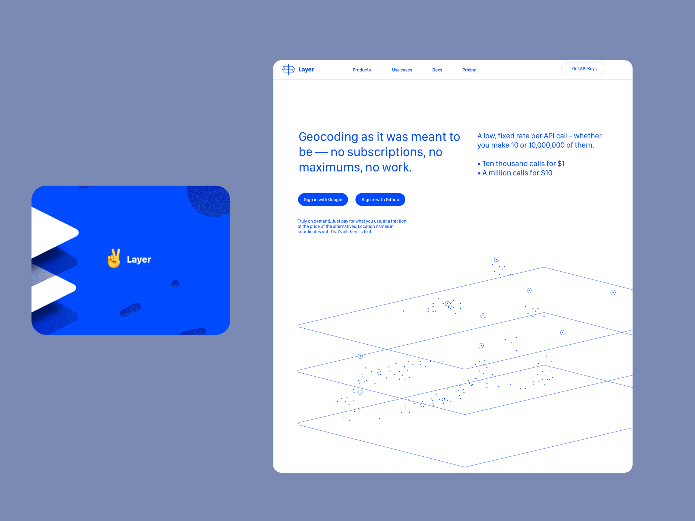
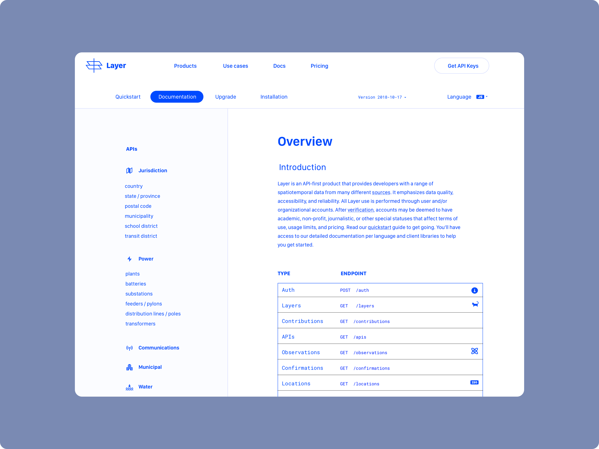

At the Guild we identified a class of low-touch products which worked well with the portfolio model — products which are data-driven, developer-facing tools that are horizontally relevant and can provide signal about market viability without a large sales team. An example of this type of product experiment was [Layer](/layer), which served as an API clearinghouse for general-purpose spatial data and geocoding services.

I led the UI design and frontend development, including authentication, integration with Stripe and the API backend. Users could create an API key and purchase credits for use by the API.

The service was conceived as a data API which would create recurring revenue without a great deal of management overhead.

We used Layer to measure market interest in API services.

As a result we created a repeatable template for API services — and a recurring passive revenue stream.

